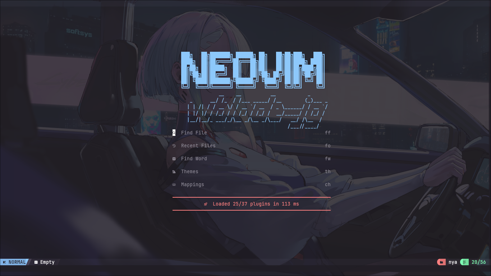
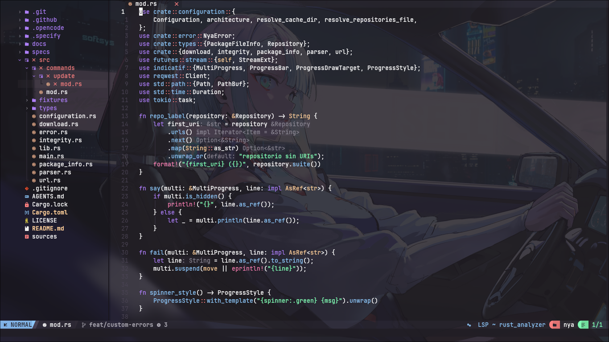
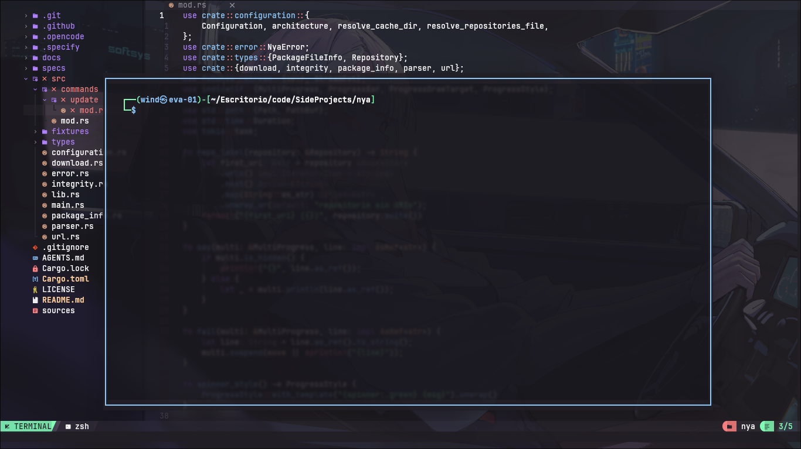
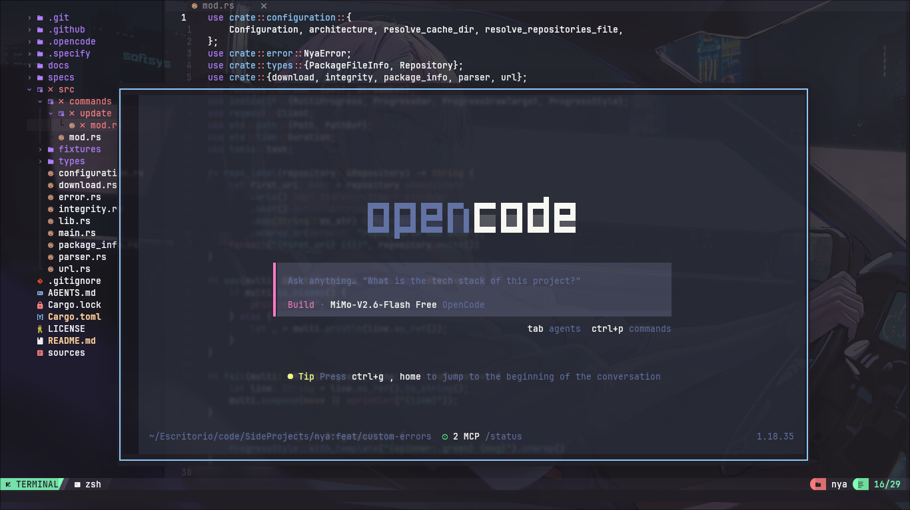
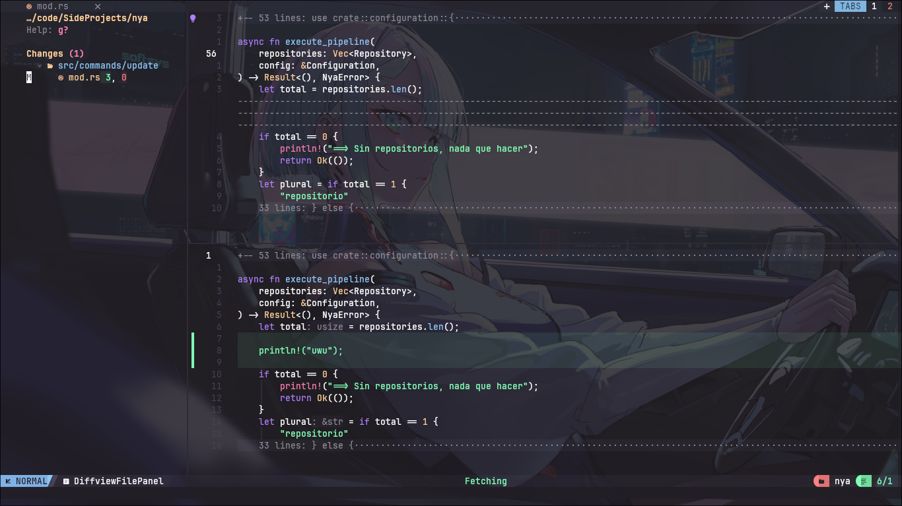
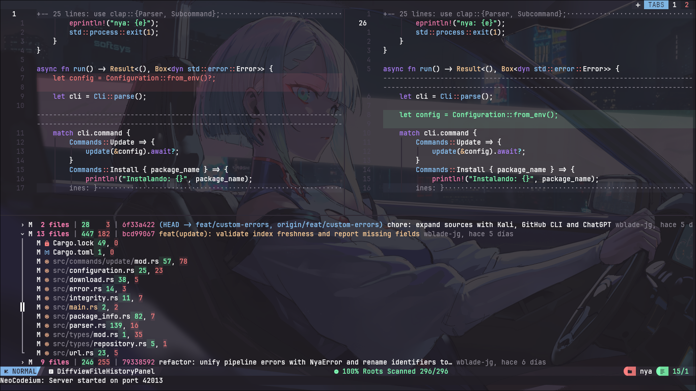

# nvim dots

Mis dots (configuraciones) de neovim. Basados en [NvChad](https://github.com/NvChad/NvChad), muy inspirados en [Kiro](https://kiro.dev) — hasta el tema de colores lo saqué de ahí.

Si te gustan, úsalos. si no, también está bien.

---

---

## Incluye

- **tema Kiro** — paleta de colores sacada del Kiro IDE de AWS. morados, cyans, verde menta
- **gestión de proyectos** con [project.nvim](https://github.com/DrKJeff16/project.nvim) — `<leader>fp` para alternar entre proyectos rápidamente
- **LSP** con nvim-lspconfig — Rust, C/C++, Python, TypeScript, HTML, CSS
- **formateo** con conform.nvim — stylua, rustfmt, ruff, prettierd, clang-format
- **AI inline** con [Codeium](https://codeium.com) — `<A-f>` para aceptar sugerencias
- **AI chat** con [CodeCompanion](https://github.com/olimorris/codecompanion.nvim) usando mimo-v2.5 vía opencode
- **diffs e historial Git** con diffview.nvim (`<leader>gd`, `<leader>gh`)
- terminal flotante centrada (75% × 70%)
- soporte para [Neovide](https://neovide.dev) con JetBrains Mono / FiraCode

---

## Mappings principales

> La tecla `<leader>` está configurada como la barra de **Espacio** (`<Space>`).

### 📑 Buffers y Tabs (Pestañas)

| Atajo | Acción |
|---|---|
| `<Tab>` | Ir al buffer siguiente |
| `<S-Tab>` | Ir al buffer anterior |
| `<leader>x` | Cerrar buffer actual |
| `<leader>b` | Crear nuevo buffer vacío |
| `gt` | Ir a la siguiente pestaña / tabpage (ej. Diffview) |
| `gT` | Ir a la pestaña anterior |
| `{n}gt` | Saltar directo a la pestaña número `n` (ej. `1gt`, `2gt`) |

### 📁 Proyectos y Búsqueda (Telescope)

| Atajo | Acción |
|---|---|
| `<leader>fp` | Selector y cambio de proyectos (`project.nvim`) |
| `<leader>ff` | Buscar archivos por nombre |
| `<leader>fw` | Buscar texto en el proyecto (*live grep*) |
| `<leader>fb` | Listar buffers abiertos |
| `<leader>fo` | Archivos recientes (*old files*) |
| `<leader>th` | Selector interactivo de temas |

### 🌲 Explorador de Archivos (nvim-tree)

| Atajo | Acción |
|---|---|
| `<C-n>` | Abrir / ocultar árbol de archivos |
| `<leader>e` | Enfocar cursor en el árbol de archivos |

### 🔀 Git (Diffview)

| Atajo | Acción |
|---|---|
| `<leader>gd` | Abrir panel de diferencias y archivos modificados (`DiffviewOpen`) |
| `<leader>gh` | Historial de commits de la rama actual (`DiffviewFileHistory`) |
| `<leader>gD` | Historial de cambios del archivo activo |
| `<leader>gc` | Cerrar Diffview y regresar al editor (`DiffviewClose`) |

### 🖥️ Terminales Flotantes e Integradas

| Atajo | Acción |
|---|---|
| `<A-i>` | Alternar terminal flotante centrada |
| `<A-h>` | Alternar terminal dividida horizontal |
| `<A-v>` | Alternar terminal dividida vertical |
| `<C-x>` | Salir del modo terminal a modo normal |

### 🤖 Inteligencia Artificial

| Atajo | Modo | Acción |
|---|---|---|
| `<A-f>` | Insertar (`i`) | Aceptar sugerencia inline de Codeium |

### 🐞 Depuración (DAP estilo VS Code)

| Atajo | Acción |
|---|---|
| `<F5>` / `<leader>dc` | Iniciar / Continuar depuración |
| `<F10>` / `<leader>do` | Paso por encima (*Step over*) |
| `<F11>` / `<leader>di` | Paso adentro (*Step into*) |
| `<F12>` / `<leader>dO` | Paso hacia afuera (*Step out*) |
| `<leader>db` | Alternar punto de interrupción (*Breakpoint*) |
| `<leader>dB` | Punto de interrupción condicional |
| `<leader>du` | Abrir / ocultar interfaz visual de DAP UI |
| `<leader>dt` | Terminar sesión de depuración |

### ⚡ Edición y Utilidades

| Atajo | Acción |
|---|---|
| `<leader>fm` | Formatear archivo activo con conform.nvim |
| `<leader>/` | Comentar / descomentar línea o bloque |
| `;` | Entrar directo a modo comando (`:`) |
| `jk` | En modo insertar, salir a modo normal (`<Esc>`) |
| `<C-s>` | Guardar archivo actual |
| `<leader>ch` | Abrir cheatsheet interactiva de NvChad |
